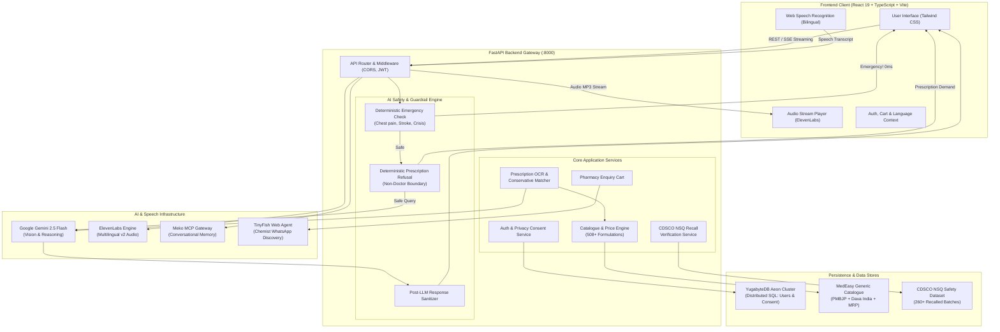

# 💊 MedEasy 
> **Empowering Bharat with Affordable Healthcare, Prescription Transparency, and Responsible AI Health Navigation**

[](LICENSE)
[](https://fastapi.tiangolo.com/)
[](https://react.dev/)
[](https://www.typescriptlang.org/)
[](https://www.yugabyte.com/)
[](https://ai.google.dev/)
[](https://elevenlabs.io/)
[](https://cdsco.gov.in/)

---

## 📌 Table of Contents
1. [The Problem](#-the-problem)
2. [The Idea & Solution](#-the-idea--solution)
3. [Key Innovations](#-key-innovations)
4. [Unique Selling Proposition (USP)](#-unique-selling-proposition-usp)
5. [Cloud & Ecosystem Integrations](#-cloud--ecosystem-integrations)
6. [System Architecture](#-system-architecture)
7. [Reliability, Usability & Scalability Engineering](#-reliability-usability--scalability-engineering)
8. [Ethical AI & Non-Doctor Guardrails](#-ethical-ai--non-doctor-guardrails)
9. [Zero-Storage Privacy Architecture](#-zero-storage-privacy-architecture)
10. [Repository Structure](#-repository-structure)
11. [Quick Start & Setup Guide](#-quick-start--setup-guide)
12. [Environment Configuration](#-environment-configuration)
13. [Automated Verification & Test Suites](#-automated-verification--test-suites)

---

## 🚨 The Problem

1. **Catastrophic Out-of-Pocket Healthcare Costs**:
   - Out-of-pocket expenditure (OOPE) accounts for nearly **50% of total healthcare spending in India**, pushing over **55 million citizens into poverty** every single year.
   - Branded pharmaceuticals command markups of **200% to 1,000%** over identical active chemical formulations.
2. **Generic Drug Information Asymmetry**:
   - The Government of India's **Pradhan Mantri Bhartiya Janaushadhi Pariyojana (PMBJP)** and initiatives like **Dava India** provide high-quality generic medicines at **50% to 90% lower prices**.
   - However, patients, especially elderly and rural citizens, lack transparent, accessible tools to compare prices between branded retail MRP and generic equivalents.
3. **Prescription Comprehension Barriers**:
   - Doctors' handwritten prescriptions are notoriously difficult to decipher, leading to patient anxiety, medication errors, or complete reliance on retail chemist brand bias.
4. **Counterfeit & Substandard Medicines (CDSCO Alerts)**:
   - The Central Drugs Standard Control Organisation (**CDSCO**) regularly publishes *Not of Standard Quality (NSQ)* drug recall alerts.
   - These alerts are buried in static government PDF notices, making them inaccessible to common citizens purchasing medicines at neighborhood retail counters.
5. **Neighborhood Pharmacy Stock Friction**:
   - Patients travel across multiple physical stores only to find generic salts out of stock, often resulting in them purchasing expensive branded substitutes out of urgency.
6. **Language & Digital Divide**:
   - Existing health apps are tailored for urban English speakers. Rural, semi-urban, and non-tech-savvy Indians require a voice-first, accessible, multilingual interface in their mother tongue.

---

## 💡 The Idea & Solution

**MedEasy** (powered by its conversational voice companion **MedSaathi**) is a unified, bilingual (**English + हिंदी**) healthcare accessibility and price transparency platform designed for Bharat. It guides patients seamlessly across the entire medication lifecycle:

```
[ Doctor's Prescription ] 
           │
           ▼
[ Multimodal Vision OCR ] ➔ Transcribes handwritten/printed prescriptions into confirmed salts
           │
           ▼
[ 3-Way Price Comparison ] ➔ Private Brand MRP vs. PMBJP Jan Aushadhi vs. Dava India (up to 90% savings)
           │
           ▼
[ Local Pharmacy Discovery ] ➔ Finds verified nearby Jan Aushadhi & retail chemists with real-time distance
           │
           ▼
[ Structured WhatsApp Handoff ] ➔ Checks live stock availability with chemists without fake e-commerce checkouts
           │
           ▼
[ CDSCO Batch Safety Auditor ] ➔ Scans packaging batches against official government recall bulletins
           │
           ▼
[ MedSaathi Voice Assistant ] ➔ Empowers citizens with voice navigation, memory, and strict AI safety guardrails
```

---

## ⚡ Key Innovations

1. **Multimodal Bilingual Voice Agent (MedSaathi / मेडसाथी)**:
   - Voice-first interface allowing users to simply speak in **Hindi or English** to search medicines, ask for price comparisons, find pharmacies, or check batch recalls.
   - Powered by **Google Gemini 2.5 Flash** for reasoning and **ElevenLabs Multilingual v2** for ultra-natural, empathetic speech synthesis.
2. **Conservative Clinical Matching Engine**:
   - Prescription extraction avoids dangerous false matches. It normalizes chemical salt compounds, dosage forms (*Tablet, Capsule, Syrup, Inhaler*), and dosage strengths (*500 mg vs 650 mg*).
   - Enforces a mandatory **human confirmation gate** before querying the catalogue. Strength mismatches or unverified substitutions are strictly flagged for review.
3. **Automated CDSCO NSQ Recall Vigilance**:
   - The first consumer-facing portal integrating an active dataset of **260+ official CDSCO Not-of-Standard-Quality recall records**.
   - Allows users to type batch numbers or capture drug packaging photos to immediately detect contaminated or recalled batches.
4. **Deterministic Pre-LLM AI Safety Guardrail**:
   - A specialized zero-delay safety engine running in front of the LLM. It intercepts medical emergencies (*chest pain, breathlessness, stroke signs*) with **instant 108/112 ambulance escalation in 0ms**, and strictly refuses to act as a doctor or prescribe antibiotics.
5. **Zero-Storage Clinical File Privacy**:
   - Strict local-first memory model: raw prescription images and clinical documents are analyzed exclusively in volatile memory (RAM) and immediately discarded. **Zero medical files are ever saved in cloud databases.**
6. **Chemist WhatsApp Stock Enquiry via TinyFish AI Agent**:
   - Automatically crawls and validates local pharmacy contact numbers and active WhatsApp channels, preparing pre-filled, formatted stock availability requests for the patient to send in one tap.

---

## 🏆 Unique Selling Proposition (USP)

| Feature | MedEasy / MedSaathi | Conventional E-Pharmacies (1mg, Apollo, PharmEasy) | Generic AI Chatbots (ChatGPT, generic LLMs) |
| :--- | :--- | :--- | :--- |
| **Pricing Philosophy** | **100% Transparent**: Highlights PMBJP Jan Aushadhi & Dava India generic salts (80-90% savings). | **Commercial**: Promotes high-margin proprietary brands and private labels. | No live Indian generic medicine pricing catalogue. |
| **Data Privacy** | **Zero-Storage Architecture**: Clinical files & prescription images are NEVER stored on cloud disks. | Stores prescriptions, health histories, and diagnostic records in commercial profiling clouds. | Logs and retains user chat queries for model training. |
| **Safety & Guardrails** | **Deterministic Non-Doctor Engine**: Refuses prescriptions, suggests safe non-medicinal home care, 0ms emergency 108/112 routing. | E-commerce checkout oriented; doctors act via asynchronous tele-consults. | Prone to medical hallucinations, dangerous dosage advice, and delay in emergencies. |
| **Accessibility** | **Voice-First for Bharat**: Bilingual English + हिंदी with Web Speech input and ElevenLabs voice playback. | Primarily text-based English mobile UI; difficult for elderly or rural citizens. | English-centric text prompt interfaces without localized healthcare workflows. |
| **Chemist Ecosystem** | **Support Local Chemists**: Structured WhatsApp inquiries to local neighborhood stores without predatory middleman fees. | Replaces local chemists with centralized corporate fulfillment warehouses. | No integration with local pharmacy directories or WhatsApp. |
| **Quality Vigilance** | **CDSCO Batch NSQ Checker**: Integrated government recall notices directly linked to search and camera review. | None: Patients cannot verify whether a dispensed batch is flagged by CDSCO. | None: Lacks real-time CDSCO batch recall awareness. |

---

## 🌐 Cloud & Ecosystem Integrations

MedEasy seamlessly ties together best-in-class developer platforms and enterprise infrastructure:

```
┌────────────────────────────────────────────────────────────────────────────────────────┐
│                                 MEDEASY CLOUD CONNECTIONS                              │
├───────────────────────┬────────────────────────┬───────────────────────────────────────┤
│ Integration Provider  │ Technology Used        │ Production Function in MedEasy        │
├───────────────────────┼────────────────────────┼───────────────────────────────────────┤
│ Google Cloud / Gemini │ Gemini 2.5 Flash       │ • Multimodal prescription image OCR   │
│                       │                        │ • Batch & expiry packaging extraction │
│                       │                        │ • MedSaathi contextual healthcare AI  │
├───────────────────────┼────────────────────────┼───────────────────────────────────────┤
│ ElevenLabs            │ eleven_multilingual_v2 │ • Ultra-realistic speech synthesis    │
│                       │ Audio REST API         │ • Natural bilingual English/Hindi TTS │
│                       │                        │ • Real-time per-message voice readouts│
├───────────────────────┼────────────────────────┼───────────────────────────────────────┤
│ YugabyteDB Aeon       │ Distributed SQL (YSQL) │ • Cloud-native multi-region resilience│
│                       │ Managed Cloud Cluster  │ • Argon2id password authentication    │
│                       │                        │ • Cryptographic privacy consent audit │
├───────────────────────┼────────────────────────┼───────────────────────────────────────┤
│ Meko Data             │ Model Context Protocol │ • Consent-gated conversational memory │
│                       │ (Meko MCP Server)      │ • Non-clinical patient preference     │
│                       │                        │ • Fail-open transient memory cache    │
├───────────────────────┼────────────────────────┼───────────────────────────────────────┤
│ TinyFish AI           │ Search & Web Agent     │ • Automated neighborhood chemist discovery│
│                       │ Automation API         │ • Validates WhatsApp messaging lines  │
│                       │                        │ • Caches verified store contacts      │
├───────────────────────┼────────────────────────┼───────────────────────────────────────┤
│ CDSCO India           │ NSQ Alert Extraction   │ • 260+ government-recalled drug batches│
│                       │ Regulatory Bulletins   │ • Proactive safety checks before purchase│
└───────────────────────┴────────────────────────┴───────────────────────────────────────┘
```

---

## 🏛️ System Architecture



---

## 🛡️ Reliability, Usability & Scalability Engineering

### 1. High Reliability & Fault Tolerance
- **Deterministic 0ms Emergency Interception**: Emergency situations bypass LLM reasoning completely. Deterministic regex engines catch cardiovascular, respiratory, stroke, and suicide red flags in 0 milliseconds, delivering immediate 108/112 emergency escalation with zero token cost and zero hallucination risk.
- **Fail-Open Transient Integrations**: If external services (e.g., Meko MCP or ElevenLabs) experience network latency or provider outages, MedEasy gracefully degrades to localized in-memory operations and standard text display without crashing user flows.
- **Conservative Medicine Matching**: In medicine matching, a false positive is far more dangerous than no match. If dosage strengths (*e.g., 500 mg vs 650 mg*) or delivery forms (*e.g., tablet vs syrup*) differ, the engine refuses automatic matching and marks the record for human pharmacist review.
- **Automated Test Coverage**: 140+ unit and integration tests covering database transactions, JWT refresh tokens, catalogue indexing, prescription OCR, and CDSCO recall verification.

### 2. Intuitive, Inclusive Usability (UI/UX)
- **Problem-Centric Dashboard**: Stripped of all technical jargon (*no "Workflow 1 vs 2" or database telemetry*). Built around direct patient utility: medicine search, prescription dropzone, MedSaathi prompt bar, active enquiry cart, and instant batch verification.
- **Full Bilingual Localization**: Complete native **English and हिंदी** support across UI labels, currency formatting (₹), dosage instructions, audio readouts, and AI responses.
- **Visual Waveform Voice Hub**: An interactive visual voice orb gives immediate tactile feedback during speech recognition, voice generation, and active playback.

### 3. Enterprise Scalability
- **Fully Asynchronous Architecture**: FastAPI backend built on top of Python `asyncio` and `uvloop`, enabling thousands of concurrent connections with minimal CPU footprint.
- **Server-Sent Events (SSE) Streaming**: MedSaathi streams AI tokens in real-time (`text/event-stream`), drastically reducing time-to-first-token (TTFT) and preventing long-lived blocked HTTP connections.
- **Distributed Relational Database (YugabyteDB Aeon)**: Horizontally scalable distributed PostgreSQL architecture ensures user authentication, active sessions, and privacy consent audits scale across global availability zones with sub-200ms latency.
- **In-Memory Catalogue Search**: 508+ generic drug formulations indexed in memory with Pandas and tokenized caching, providing sub-5ms search responses without database bottlenecks.

---

## 🩺 Ethical AI & Non-Doctor Guardrails

MedSaathi is explicitly designed as a **Healthcare Information Assistant, NOT a Medical Practitioner**:
1. **Never Prescribes Drugs**: Strictly refuses requests to prescribe antibiotics, prescription drugs, or modify physician-ordered dosages.
2. **Never Diagnoses Diseases**: When asked *"what disease do I have?"* or *"diagnose me"*, MedSaathi declines and directs the patient to an in-person clinical examination.
3. **Allergy-Aware Home Care Only**: When Meko conversational memory notes patient-reported allergies (*e.g., penicillin, sulfa*), MedSaathi cautions the user to inform their doctor and suggests **safe home remedies and non-medicinal prevention only** (*e.g., warm salt-water gargle, steam inhalation, hydration, rest*), never medicines.
4. **Post-LLM Response Sanitizer**: A regular-expression sanitization filter parses Gemini outputs to catch and neutralize any inadvertent prescriptive claims before they reach the user.

---

## 🔒 Zero-Storage Privacy Architecture

Patient trust is non-negotiable in digital healthcare:
- **No Cloud Document Storage**: Prescriptions (JPG, PNG, PDF) and medicine pack photos uploaded by the user are parsed entirely within volatile server RAM. File buffers are discarded immediately upon OCR completion.
- **Zero Medical Data in Cloud Databases**: YugabyteDB Aeon stores **only** user credentials (salted Argon2id hashes), patient profile names, and cryptographic privacy consent flags (`privacy_consents`).
- **Consent-Gated AI Memory**: Meko conversational memory is **strictly disabled by default**. The user must explicitly toggle the Memory switch to allow non-clinical preferences to be remembered across visits. Memory can be purged at any time with the one-click **Reset** control.

---

## 📂 Repository Structure

```text
hackcbs/
├── backend/
│   ├── app/
│   │   ├── ai/
│   │   │   ├── guardrails/        # Deterministic emergency & non-doctor guardrails
│   │   │   ├── chains/            # LangChain healthcare orchestration pipelines
│   │   │   ├── memory/            # Meko MCP memory providers & context models
│   │   │   └── prompts/           # Bilingual healthcare system prompts
│   │   ├── api/routes/            # FastAPI REST endpoints (auth, ai, medicines, prescriptions, stores, safety)
│   │   ├── core/                  # Security, JWT tokens, and global configuration
│   │   ├── data/                  # Generic medicines catalogue & CDSCO NSQ dataset
│   │   ├── db/                    # SQLAlchemy models & YugabyteDB connection pool
│   │   ├── models/                # Pydantic request/response schemas
│   │   └── services/              # Gemini OCR, ElevenLabs voice, TinyFish agent, CDSCO matcher
│   ├── tests/                     # Comprehensive pytest test suite (140+ tests)
│   ├── requirements.txt           # Python dependencies
│   └── README.md                  # Backend technical documentation
├── frontend/
│   ├── src/
│   │   ├── api/                   # Typed API client with JWT refresh interceptors
│   │   ├── components/            # Reusable UI components (Navbar, Assistant, VoiceVisualizer, etc.)
│   │   ├── context/               # AuthContext, CartContext, LanguageContext
│   │   ├── i18n/                  # Bilingual Hindi/English translation strings & formatters
│   │   ├── pages/                 # MedSaathi, Dashboard, Medicines, Scan, Stores, BatchSafety, Auth
│   │   └── types.ts               # Full-stack TypeScript data contracts
│   ├── package.json               # Node.js dependencies
│   ├── vite.config.ts             # Vite build & proxy configuration
│   └── vitest.config.ts           # Vitest unit & component test configuration
└── README.md                      # Project root documentation (this file)
```

---

## 🚀 Quick Start & Setup Guide

### Prerequisites
- **Python**: 3.11 or higher
- **Node.js**: v18 or higher (v20+ recommended)
- **Git**

### 1. Clone the Repository
```bash
git clone https://github.com/aparmitsrivastav01-hub/hackcbs.git
cd hackcbs
```

### 2. Backend Setup (FastAPI)
```bash
cd backend

# Create and activate Python virtual environment
python -m venv venv

# Windows (PowerShell):
.\venv\Scripts\Activate.ps1
# macOS/Linux:
source venv/bin/activate

# Install dependencies
pip install -r requirements.txt

# Create environment configuration
copy .env.example .env   # On Windows
cp .env.example .env     # On macOS/Linux

# Start FastAPI development server
uvicorn app.main:app --reload --host 127.0.0.1 --port 8000
```
- **API Base**: `http://127.0.0.1:8000`
- **Interactive Swagger Documentation**: `http://127.0.0.1:8000/docs`

### 3. Frontend Setup (React 19 + Vite)
```bash
cd ../frontend

# Install dependencies
npm install

# Start Vite dev server
npm run dev
```
- **Web Application**: `http://localhost:5173`

---

## ⚙️ Environment Configuration

Create a `.env` file in `backend/` with the following variables:

```ini
# Core AI & Speech Providers
GEMINI_API_KEY=your_gemini_api_key_here
GEMINI_MODEL=gemini-2.5-flash
ELEVENLABS_API_KEY=your_elevenlabs_api_key_here
ELEVENLABS_VOICE_ID=your_voice_id_here
ELEVENLABS_MODEL_ID=eleven_multilingual_v2

# YugabyteDB Aeon Distributed SQL Database
# Production YugabyteDB format:
DATABASE_URL=postgresql://<username>:<password>@<yugabyte_host>:5433/<database>?sslmode=require
# Local fallback (auto-selected if unset):
# DATABASE_URL=sqlite+aiosqlite:///medeasy_accounts.db

# Authentication Security (JWT & Password Hashing)
JWT_SECRET=generate_with_python_secrets_token_hex_32
JWT_ALGORITHM=HS256
ACCESS_TOKEN_EXPIRE_MINUTES=30
REFRESH_TOKEN_EXPIRE_DAYS=7

# Meko MCP Patient Memory Integration
MEKO_ENABLED=true
MEKO_API_KEY=your_meko_key_here
MEKO_MCP_URL=https://mcp.mekodata.ai/mcp
MEKO_DATAPACK_ID=your_datapack_id
MEKO_CONSENT_DEFAULT=false

# TinyFish Chemist Discovery Agent
TINYFISH_API_KEY=your_tinyfish_key_here
PHARMACY_CACHE_TTL_SECONDS=3600

# CORS Allowed Origins
MEDEASY_CORS_ORIGINS=http://localhost:5173,http://localhost:5174,http://127.0.0.1:5173
```

---

## 🧪 Automated Verification & Test Suites

The entire codebase is verified with end-to-end automated unit and integration tests:

### Backend Tests (Pytest)
```bash
cd backend
python -m pytest -v
```
- `test_database_models.py`: YugabyteDB constraints, SQLAlchemy schema models, privacy column checks.
- `test_auth_routes.py`: Signup, Argon2id hashing, login, JWT refresh token rotation, consent endpoints.
- `test_ai_guardrails.py`: Emergency 108/112 interception, prescription refusal, allergy awareness, response sanitization.
- `test_prescriptions.py`: Multimodal OCR, conservative salt matching, dosage validation, format validation.
- `test_medicines.py`: Catalogue loading, search tokenization, Jan Aushadhi vs Dava India comparisons.
- `test_safety.py`: CDSCO NSQ alert lookups, batch number verification.
- `test_cart_pharmacy.py`: Cart management, duplicate line merging, store discovery.
- `test_stores_whatsapp.py`: TinyFish WhatsApp extraction, distance calculations.
- `test_ai_voice.py`: ElevenLabs speech synthesis routes and error fallbacks.

### Frontend Quality & Test Suite (Vitest & Oxlint)
```bash
cd frontend

# Run Oxlint (0 errors, 0 warnings across 58 files)
npm run lint

# Run TypeScript compilation & Production Build
npm run build

# Run Vitest Component Test Suite
npm test -- --run
```

---

## 👥 Contributors & Acknowledgements
- **Team MedEasy**: Built with passion for **HackCBS** to democratize healthcare price transparency and safe AI navigation for every Indian citizen.
- Special thanks to the **Jan Aushadhi (PMBJP)** initiative, **CDSCO**, **Google Gemini**, **ElevenLabs**, **YugabyteDB**, **Meko Data**, and **TinyFish AI**.

---

<p align="center">
  <b>Built for Bharat • Swasth Bharat, Samriddh Bharat 🇮🇳</b>
</p>
