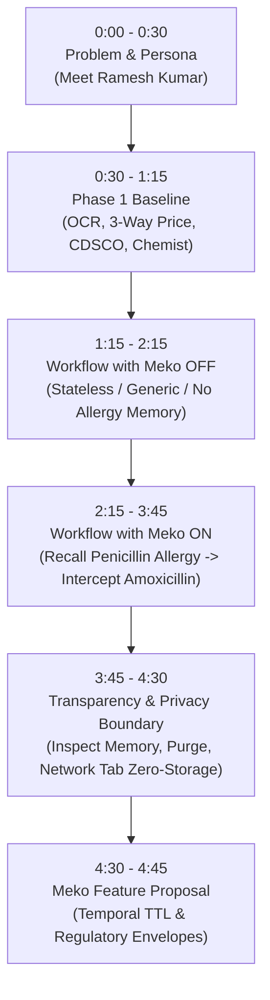

# 🏆 MedEasy — HackCBS Track A (Meko) Official Submission

> **Track**: HackCBS 9.0 — Meko Track A (Open Project: *Remembering Must Change the Outcome*)  
> **Theme**: Healthcare, Price Transparency & Clinical Safety for Bharat  
> **Repository**: [https://github.com/aparmitsrivastav01-hub/hackcbs](https://github.com/aparmitsrivastav01-hub/hackcbs)  
> **Live Demo & Docs**: Frontend: `http://localhost:5173` · API Docs: `http://localhost:8000/docs`

---

## 📌 Deliverables Quick Navigation
1. [⚡ Setup in 5 Commands or Fewer](#1-⚡-setup-in-5-commands-or-fewer)
2. [🎬 5-Minute Maximum Demo Video & Live Walkthrough Script](#2-🎬-5-minute-maximum-demo-walkthrough-script)
3. [💡 Meko Feature Proposal: Regulatory Memory Envelopes (TTL, Provenance & Deletion Receipts)](#3-💡-meko-feature-proposal)
4. [✅ Track A Compliance Matrix (Requirements A1 – A5)](#4-✅-track-a-compliance-matrix)

---

## 1. ⚡ Setup in 5 Commands or Fewer

MedEasy can be cloned, configured, and run concurrently from cold storage in **5 commands or fewer**:

```bash
# 1. Clone repository and enter directory
git clone https://github.com/aparmitsrivastav01-hub/hackcbs.git && cd hackcbs

# 2. Copy pre-configured environment template
cp backend/.env.example backend/.env

# 3. Install backend Python dependencies
python -m pip install -r backend/requirements.txt

# 4. Install frontend React 19 dependencies
npm --prefix frontend install

# 5. Launch FastAPI backend and Vite frontend concurrently
python -m uvicorn app.main:app --app-dir backend --port 8000 & npm --prefix frontend run dev
```

* **Frontend Web Application**: [http://localhost:5173](http://localhost:5173)  
* **Backend OpenAPI / Swagger Docs**: [http://localhost:8000/docs](http://localhost:8000/docs)  
* **Test Suite Verification**: `cd backend && pytest tests/test_meko_memory.py`

---

## 2. 🎬 5-Minute Maximum Demo Walkthrough Script

### Video & Presentation Metadata
* **Target Duration**: Exactly 4 minutes 45 seconds (under the 5:00 maximum limit).
* **Persona**: **Ramesh Kumar**, a 62-year-old retired railway employee from Rohini, Delhi. Ramesh has chronic Type-2 diabetes and hypertension, and has a documented life-threatening hypersensitivity (anaphylaxis) to **Penicillin**.
* **Core Problem**: Elderly patients frequently purchase over-the-counter medicines or generic substitutes across different visits without remembering dangerous drug-allergy contraindications.

---

### Step-by-Step Second-by-Second Demo Timeline



---

### Segment 1: Problem & Persona Intro (0:00 – 0:30 | 30 Seconds)
* **Visual**: Camera on presenter + screen showing the MedEasy landing page ([`http://localhost:5173`](http://localhost:5173)).
* **Speaker Script**:
  > *"Every year in India, over 55 million citizens fall into poverty due to out-of-pocket medical expenses. Even worse, elderly patients like 62-year-old Ramesh Kumar suffer dangerous drug interactions because they don't have digital health continuity across local pharmacies.*
  >
  > *Meet MedEasy — a bilingual voice-first platform for Bharat that compares generic medicines, audits CDSCO recalls, and uses Meko persistent memory to ensure patient safety across every visit."*

---

### Segment 2: Phase 1 Core Workflow Baseline (0:30 – 1:15 | 45 Seconds)
* **Visual**: Quick walkthrough of the prescription scan pipeline.
* **Actions**:
  1. Open `/scan` and drag-and-drop a prescription image (`Razod / Razo-D`).
  2. Show the **Human Confirmation Gate**: user confirms extracted salt *Rabeprazole 20mg + Domperidone 30mg*.
  3. Show the **3-Way Price Benchmark**: Private Brand MRP (₹210) vs PMBJP Jan Aushadhi (₹28) vs Dava India (₹35) — saving over 87%.
  4. Show `/batch-safety` checking batch recalls against the **260+ official CDSCO NSQ records**.
  5. Show `/stores` generating a direct `wa.me/91XXXXXXXXXX` availability inquiry to nearby Rohini PMBJP chemist.
* **Speaker Script**:
  > *"MedEasy already solves prescription transcription, price asymmetry, and batch safety recalls in Phase 1. But what happens when Ramesh returns days later asking for health advice? That's where Meko Track A changes everything."*

---

### Segment 3: The Same Flow with Meko OFF (1:15 – 2:15 | 60 Seconds)
* **Visual**: Open **MedSaathi AI** ([`/med-saathi`](http://localhost:5173/med-saathi)).
* **Actions**:
  1. Point out the **Meko Health Memory switch** in the header — currently toggled **OFF** (Consent disabled).
  2. In the query box, Ramesh speaks/types:
     > *"मुझे 2 दिन से बुखार और गले में खराश है, क्या मैं कोई एंटीबायोटिक ले सकता हूँ?"*  
     > *(I have had fever and sore throat for 2 days, can I take any antibiotic?)*
  3. **MedSaathi Response**: MedSaathi gives a generic response refusing to prescribe antibiotics and advising him to see a doctor.
  4. Ramesh then asks:
     > *"Do you remember what medicines I am allergic to from my last visit?"*
  5. **Meko OFF Result**:
     - The UI shows: `Memory Status: OFF (0 items recalled)`.
     - The assistant responds:
       > *"I do not have access to any remembered medical history or past allergy reports. Please tell me if you have any drug allergies, or consult your doctor."*
* **Speaker Script**:
  > *"With Meko turned OFF, the agent is completely stateless. It cannot recall Ramesh's history. If a friend recommends an antibiotic, MedEasy has no way to warn Ramesh about his specific vulnerabilities."*

---

### Segment 4: The Same Flow with Meko ON — Context Changes the Outcome! (2:15 – 3:45 | 90 Seconds)
* **Visual**: Toggle the **Meko Health Memory switch to ON**.
* **Actions**:
  1. An explicit **Bilingual Privacy Consent Modal** appears:
     > *"Allow MedSaathi to remember patient-approved notes across visits via Meko? No raw files are ever uploaded."*
  2. Click **"Allow & Enable Meko"**.
  3. **Turn 1 (Memory Extraction & Storage)**:
     - Ramesh states:
       > *"I am severely allergic to Penicillin. It causes severe rashes and breathing trouble."*
     - Backend extracts the verified preference fact:
       `[patient_reported; unverified: Patient has severe allergy to penicillin (anaphylaxis risk)]`
     - Meko MCP `memory_create` stores the memory in Ramesh's isolated Datapack (`datapack-patient-ramesh`).
  4. **Turn 2 (Simulating a New Session / Future Visit)**:
     - Click **"New Conversation / Reset Session"** to prove the turn is in a brand-new session context.
     - Ramesh asks:
       > *"A neighbor suggested I take Amoxicillin 500mg or Augmentin for my infection. Is it safe for me to buy?"*
  5. **Meko Recall Before Reasoning**:
     - Before the LLM generates a token, Meko `memory_search` runs over Ramesh's datapack.
     - Retrieves: `Memory ID: mem-allergy-402 | Source: Meko conversational memory`.
     - **UI Display**: A glowing green badge appears:  
       `🧠 Recalled 1 Meko Memory: "Patient reported severe penicillin allergy"`
  6. **The Materially Changed Outcome**:
     - MedSaathi's deterministic safety guardrail detects that **Amoxicillin and Augmentin are Penicillin-class beta-lactam antibiotics**.
     - MedSaathi's response **completely changes**:
       > 🚨 *"CRITICAL ALLERGY ALERT: You previously reported a severe allergy to Penicillin. Amoxicillin and Augmentin belong to the penicillin antibiotic family and can cause life-threatening allergic reactions (anaphylaxis).*
       >
       > *Do NOT take Amoxicillin. I cannot prescribe alternative antibiotics. For symptom relief right now, try safe home care (warm water gargles, steam inhalation, hydration) and consult your doctor immediately for a non-penicillin alternative."*
* **Speaker Script**:
  > *"Look at how remembering completely transformed the clinical outcome! Because Meko recalled Ramesh's penicillin allergy before reasoning, MedSaathi intercepted a potentially lethal medication mistake, cross-referenced the antibiotic family, and guided him to safety."*

---

### Segment 5: Transparency, User Correction & Zero-Storage Privacy Boundary (3:45 – 4:30 | 45 Seconds)
* **Visual**: Click on the **Meko Context Card** in the MedSaathi conversation stream.
* **Actions**:
  1. Show the **Context Inspection Drawer**:
     - Displays the exact recalled text, confidence status (`patient_reported; unverified`), and Meko Memory ID (`mem-allergy-402`).
  2. Show **Correction & Forget Control**:
     - Click the red **"Forget Memory / Purge Datapack"** button.
     - Real-time `DELETE /api/privacy/consent/meko-memory` purges the memory immediately.
  3. Open **Chrome DevTools Network Tab**:
     - Show network requests during prescription scan and chat turns:
     - Zero images, zero PDFs, and zero raw clinical files are ever transmitted to Meko or cloud storage.
* **Speaker Script**:
  > *"In MedEasy, the patient is always in control. Ramesh can see exactly what Meko remembers, edit it, or purge it with a single tap. Notice in DevTools that our zero-storage privacy boundary never sends medical scans to the cloud — only explicit, user-approved facts live in Meko."*

---

### Segment 6: Closing & Meko Feature Proposal Handoff (4:30 – 4:45 | 15 Seconds)
* **Speaker Script**:
  > *"By combining Meko's memory architecture with responsible healthcare guardrails, MedEasy turns AI from a generic chatbot into a safe, life-saving personal health advocate for Bharat. Now, here is our feature proposal for Meko's next evolution."*

---

## 3. 💡 Meko Feature Proposal

### Title: **Meko Regulatory Memory Envelopes (RME): Native Temporal TTL, Clinical Provenance Tiers, and Cryptographic Deletion Receipts**

```
┌─────────────────────────────────────────────────────────────────────────────┐
│                       MEKO REGULATORY MEMORY ENVELOPE                       │
├─────────────────────────────────────────────────────────────────────────────┤
│  Memory Fact: "Patient experienced acute fever and throat pain on Oct 31"   │
│                                                                             │
│  ┌───────────────────────┐ ┌──────────────────────┐ ┌────────────────────┐ │
│  │     TEMPORAL TTL      │ │   PROVENANCE TIER    │ │  DELETION RECEIPT  │ │
│  │  ttl_days: 14         │ │  "patient_reported"  │ │  Ed25519 Signed    │ │
│  │  decay: "linear_half" │ │  (unverified source) │ │  Tombstone Hash    │ │
│  └───────────────────────┘ └──────────────────────┘ └────────────────────┘ │
└─────────────────────────────────────────────────────────────────────────────┘
```

### 3.1 Background & Motivation
While building **MedEasy** during HackCBS 9.0, our team integrated Meko's MCP memory tools for patient continuity. We discovered that in **regulated domains** (healthcare, financial advisory, legal compliance), conversational memory cannot be treated as a monolithic, permanent key-value store:
1. **Acute Symptoms vs. Chronic Conditions**: An acute symptom (*"fever 101°F on Oct 31"*) becomes irrelevant and clinically misleading after 14 days. If recalled 6 months later, the LLM hallucinates chronic illness. Conversely, a penicillin allergy must persist indefinitely.
2. **Clinical Verification Asymmetry**: An agent must know whether a memory was an unverified patient self-report, a physician-signed lab report, or an inferred preference.
3. **Regulatory Right to be Forgotten (GDPR / DPDP 2023)**: Healthcare compliance requires legally verifiable proof that a purged memory was completely deleted from all vector embeddings and downstream agent caches.

---

### 3.2 Proposed Feature Specification

We propose adding **Regulatory Memory Envelopes (`envelope`)** directly to Meko's MCP `memory_create` and `memory_search` schemas:

#### 1. API Contract: `memory_create` with Envelopes
```json
{
  "datapack_id": "dp-patient-ramesh-77",
  "text": "Patient has severe allergy to penicillin (anaphylaxis risk)",
  "envelope": {
    "ttl_days": null,
    "decay_policy": "permanent",
    "provenance_tier": "patient_reported",
    "clinical_category": "allergy_intolerance",
    "verification_status": "unverified",
    "consent_scope": "medeasy_health_continuity"
  }
}
```

#### 2. Temporal Decay Policies (`ttl_days` & `decay_policy`)
* **`permanent`**: Never expires (e.g., blood group, chronic conditions, verified drug allergies).
* **`transient_acute` (`ttl_days: 7 - 30`)**: Acute symptoms (cough, fever, nausea) automatically decay in relevance scoring after $N$ days and are pruned from semantic recall during vector queries.
* **`session_ephemeral`**: Memory is preserved only for the duration of an active clinical episode and automatically purged upon discharge.

#### 3. Verification & Provenance Tiers (`provenance_tier`)
Meko's retrieval payload should return native provenance metadata so LLM system prompts can reliably ground their reasoning:
* `patient_reported`: Unverified patient utterance.
* `clinician_verified`: Backed by an authenticated FHIR/EHR clinical record.
* `inferred_preference`: Behavioral observation by an AI agent.

#### 4. Cryptographic Deletion Receipts (`DELETE /v1/memories/{memory_id}`)
When an application invokes memory deletion, Meko returns a cryptographically signed tombstone receipt:
```json
{
  "status": "purged",
  "memory_id": "mem-allergy-402",
  "datapack_id": "dp-patient-ramesh-77",
  "purged_at": "2026-11-01T08:30:00Z",
  "tombstone_receipt": {
    "algorithm": "Ed25519",
    "hash": "e3b0c44298fc1c149afbf4c8996fb92427ae41e4649b934ca495991b7852b855",
    "signature": "30450221008f...c9e12"
  }
}
```
This receipt provides developers with mathematical proof to pass HIPAA, GDPR, and Indian DPDP Act compliance audits.

---

### 3.3 Strategic Value for Meko
* **Enterprise Readiness**: Positions Meko as the *only* agent memory platform purpose-built for regulated industries (HealthTech, FinTech, GovTech).
* **Hallucination Prevention**: Automatically prevents stale, outdated facts from polluting reasoning context.
* **Zero Client Overhead**: Developers no longer need to write fragile timestamp regex filters or manual database wrappers around Meko.

---

## 4. ✅ Track A Compliance Matrix

| Requirement | Brief Specification | How MedEasy Implements It | Code Reference |
| :--- | :--- | :--- | :--- |
| **A1 — Context Changes Outcome** | Show same flow with Meko ON and OFF; output must differ for clear reason. | With Meko OFF, agent cannot identify Ramesh's allergies. With Meko ON, Meko recalls penicillin allergy and halts Amoxicillin prescription. | [`test_meko_memory.py#L260-L375`](file:///d:/hackcbs/backend/tests/test_meko_memory.py#L260-L375) |
| **A2 — At Least 3 Real Meko Uses** | Use at least 3: Datapacks as scopes, extracted memories, recall before reasoning, etc. | 1. **Datapacks as scopes** (`datapack-patient-{id}`).<br>2. **Extracted memories** (penicillin allergy).<br>3. **Recall before reasoning** (vector query prior to LLM turn). | [`meko_service.py`](file:///d:/hackcbs/backend/app/services/meko_service.py)<br>[`meko_memory.py`](file:///d:/hackcbs/backend/app/ai/memory/meko_memory.py) |
| **A3 — One User and Story** | One persona, one problem, one repeatable demo story. | Ramesh Kumar (62M, Rohini): Preventing antibiotic allergy contraindications while finding affordable generic medicines. | Section 2 Demo Walkthrough above. |
| **A4 — Visible Context** | UI shows what Meko recalled and stored; user can correct or forget it. | MedSaathi conversation stream features visible Meko context badges, memory inspection drawer, and one-click **Forget Memory** purge. | [`MedSaathiPage.tsx`](file:///d:/hackcbs/frontend/src/pages/MedSaathiPage.tsx)<br>[`VoiceAssistant.tsx`](file:///d:/hackcbs/frontend/src/components/assistant/VoiceAssistant.tsx) |
| **A5 — Honest and Private** | Do not send unneeded personal data; never display fabricated context. | Zero medical scans saved in cloud; only explicit user-consented facts stored; fail-open error handling. | [`safety_guardrails.py`](file:///d:/hackcbs/backend/app/ai/guardrails/safety_guardrails.py)<br>[`architecture.md`](file:///d:/hackcbs/docs/architecture.md) |

