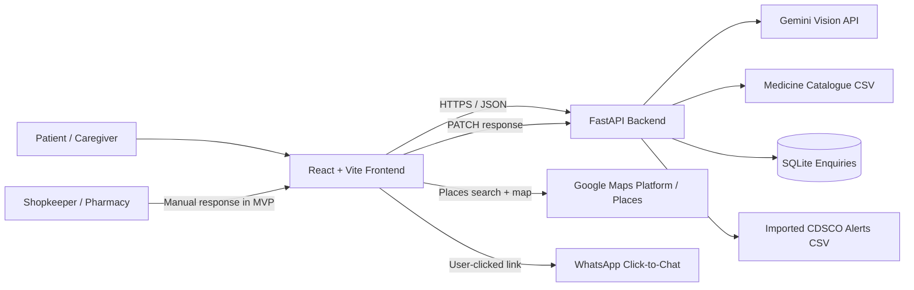

# MedEasy — Technical Architecture

## 1. Architecture objective

Deliver one maintainable vertical slice using the existing stack and code where possible. Avoid a rewrite, extra databases, premature microservices or sponsor-driven technology additions.

## 2. Logical architecture

The browser owns the user journey and user confirmation. The backend owns deterministic catalogue logic, Gemini calls, enquiry persistence and batch-alert matching. External provider results are displayed with their limitations.

## 3. Components and responsibilities

### 3.1 Frontend — React + Vite

Responsibilities:

- Routing/navigation and responsive UI.
- Upload validation for immediate UX feedback (backend validation remains authoritative).
- OCR extraction request and editable review form.
- Explicit confirmation before calling confirmed-search API.
- Catalogue results, comparison presentation and cart state.
- Geolocation permission, pharmacy result list/map and provider attribution.
- WhatsApp prefilled URL construction and user-initiated open.
- Enquiry creation and a small manual/demo response form.
- Batch-check form/result presentation.
- Clear data-status, simulation and safety copy.

Do not call Gemini directly from the browser. Do not embed a Gemini API key in Vite variables.

### 3.2 Backend — Python + FastAPI

Responsibilities:

- Serve health, statistics, category, medicine-search and comparison routes.
- Validate uploads, preprocess image/PDF and call Gemini Vision.
- Validate confirmed prescription items before search.
- Save, read and update pharmacy enquiry records in SQLite.
- Load and match imported CDSCO alert CSV records.
- Configure CORS and server-side secrets.
- Return explicit error/status values so the frontend can render safe states.

### 3.3 Catalogue data

- Source file is a 300-row CSV with eight columns (see `datamodels.md`).
- Load deterministically; fail visibly if the required file is missing or malformed.
- Never silently replace missing prices with zero.
- Preserve the original row and field names unless a migration is explicitly implemented.
- Add provenance/pack columns only through a planned data migration; do not pretend they already exist.

### 3.4 Gemini Vision

- Backend-only integration.
- Model identifier must be configurable through environment, not hard-coded throughout code.
- Most recently reported local working setting: `GEMINI_MODEL=gemini-3.8-flash`; verify availability in the actual environment before relying on it.
- Return structured JSON with candidate medicines and explicit uncertainty markers.
- Gemini output is untrusted; parse and validate it with a schema before returning it to the client.

### 3.5 Pharmacy places

Preferred path: Google Maps Platform Places in the browser, with a restricted browser API key and only required APIs enabled. The team previously reported a Google API key, but an existing key alone is not proof of working Places search.

If live Places is not configured:

- Use a separate curated demo directory.
- Label the list “Demo pharmacy directory” or equivalent.
- Do not visually imply that the directory is a live map-provider response.

### 3.6 WhatsApp

- Construct a user-clicked `wa.me` URL.
- Encode the message safely.
- User must review and manually send it.
- No automated send/receive in MVP.

### 3.7 Enquiry persistence

- Existing described backend uses SQLite.
- Verify database location and file persistence in current runtime.
- Local SQLite may be acceptable for hackathon demonstration.
- Deployed ephemeral filesystems can lose the database. Configure persistent disk/volume before claiming durable storage.
- Do not expose list/get/update endpoints publicly without authentication and ownership checks.

### 3.8 CDSCO alert data

- Backend loads a local CSV with the eight specified fields.
- No live crawl or dynamic official API is assumed.
- The CSV may be empty unless actual verified records are imported.
- Provide dataset status: availability, record count, coverage period and last-updated metadata if known.
- If metadata is not known, say “not recorded”; do not guess.

## 4. Runtime topology

### Local cross-laptop development

The frontend and backend are reported to be on separate laptops. For a shared LAN:

1. Start FastAPI bound to `0.0.0.0:8000` on the backend laptop.
2. Find the backend laptop's LAN IP address.
3. Set frontend `VITE_API_BASE_URL=http://<BACKEND_LAPTOP_LAN_IP>:8000`.
4. Set backend `CORS_ORIGINS` to the exact frontend origin (for example `http://localhost:5173` if Vite is accessed locally from the frontend laptop).
5. Allow port 8000 through the backend machine firewall for the trusted local network.
6. Test `/health` from the frontend laptop, not just from the backend laptop.

**Do not use `localhost` in the frontend's backend URL** to reach another laptop; `localhost` means the current device.

### Deployment

- Frontend: static hosting with HTTPS.
- Backend: a persistent service/container with environment variables and logs.
- SQLite: persistent disk only for a demo; for multi-user production, plan an authenticated managed database migration.
- CORS: explicit frontend origin allowlist.
- Secrets: backend environment only.
- Uploads: avoid persistent storage; clean temporary files in `finally` blocks.

## 5. Data and request boundaries

| Data | Browser | Backend | External service |
|---|---|---|---|
| Prescription image | Upload temporarily | Validate/preprocess/pass to model; do not persist by default | Gemini Vision provider processes image content |
| Extracted medicine draft | Review/edit | Generate draft only | None after extraction |
| Confirmed medicine list | User-confirmed request | Search catalogue | None |
| Catalogue rows/prices | Display | Load/query CSV | Original source provenance may be external; not fetched live by default |
| Pharmacy place | Display and select | Store selected public details in enquiry | Google Places if configured |
| WhatsApp message | User reviews/opens | Store enquiry only | WhatsApp opens user chat; user presses Send |
| Shopkeeper response | Manual form | Persist in SQLite | None in MVP |
| Batch alert data | Display result | Match imported CSV | CDSCO source records imported manually/offline |

## 6. Security and privacy architecture

- Gemini key never reaches the browser.
- Google Maps browser key must be referrer-restricted, quota-limited and limited to necessary APIs.
- Never log raw prescription images, full OCR text, patient identity or instructions.
- Avoid sending prescription images to pharmacies.
- Use temporary upload files with deterministic cleanup.
- Limit upload size to the backend's reported 10 MB and PDF page count to four unless requirements change.
- Validate extension and actual file signature/MIME; do not trust client filename.
- Sanitize and URL-encode WhatsApp text.
- Rate-limit upload endpoint and protect it from abusive usage where feasible.
- Add authentication and authorization before exposing enquiry list/get/update APIs to public users.
- Keep secrets out of Git; rotate any key ever exposed in screenshots, chat logs or repository history.
- Do not commit `.env`; provide `.env.example` with placeholders only.

## 7. Observability and reliability

Log:

- request ID, endpoint, duration, status code;
- OCR latency and outcome category (`success`, `low_confidence`, `provider_error`, `invalid_file`) without storing sensitive extracted content;
- catalogue file load status and row count;
- enquiry create/update success/failure;
- batch dataset availability, record count and checker outcome.

Do not log:

- image bytes, raw prescription text, diagnoses, patient identifiers, phone numbers or full WhatsApp messages.

Frontend must handle network timeout, backend unavailable, invalid response, empty result, permission denied, provider quota failure and dataset unavailable.

## 8. Architecture decisions — locked for MVP

| Decision | Choice | Rationale |
|---|---|---|
| Frontend | Reuse React + Vite | Already reported as the frontend stack. |
| Backend | FastAPI | Existing tested service. |
| Catalogue | CSV + pandas | Sufficient for 300 entries. |
| Enquiry store | Existing SQLite | Keep current implementation; verify persistence. |
| OCR/vision | Gemini Vision | Existing meaningful multimodal use. |
| Map search | Places if verified; labelled fallback otherwise | Avoid fake live inventory/data. |
| Messaging | WhatsApp click-to-chat | Feasible without claiming automation. |
| Alert checker | Local imported CSV | Existing functionality; bounded claims. |
| Auth | Defer only for local/private demo | Public exposure without auth is not acceptable. |

## 9. Explicitly rejected architecture choices

- Microservices for a hackathon MVP.
- A separate LLM/agent for price calculation or batch matching.
- Browser-side Gemini secret.
- Blockchain for the current problem.
- Multiple database engines without a demonstrated requirement.
- Live inventory claims without a pharmacy integration.
- Automated WhatsApp claims without Cloud API implementation and consent/compliance handling.
