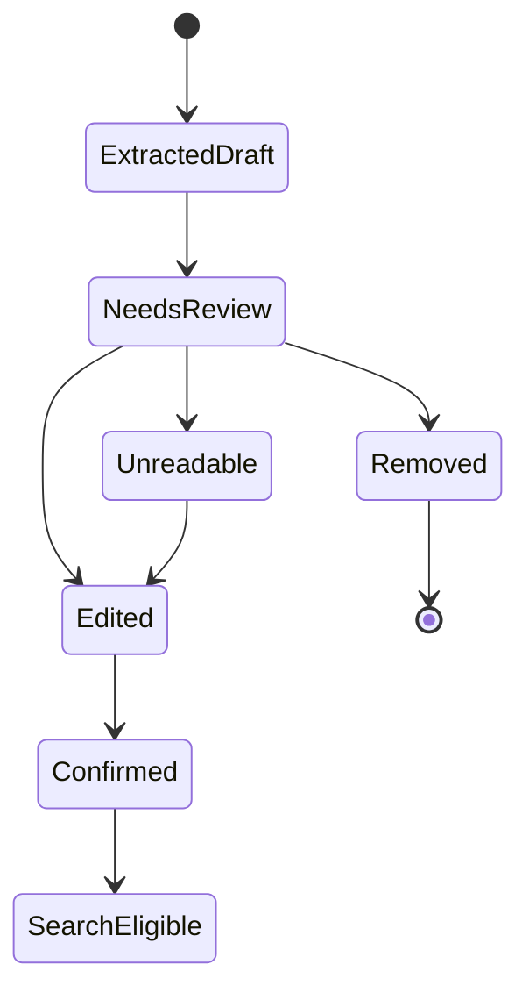
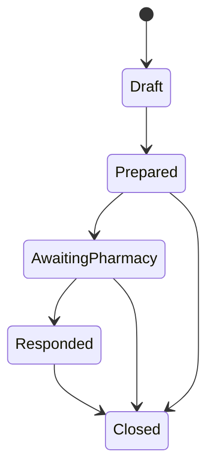
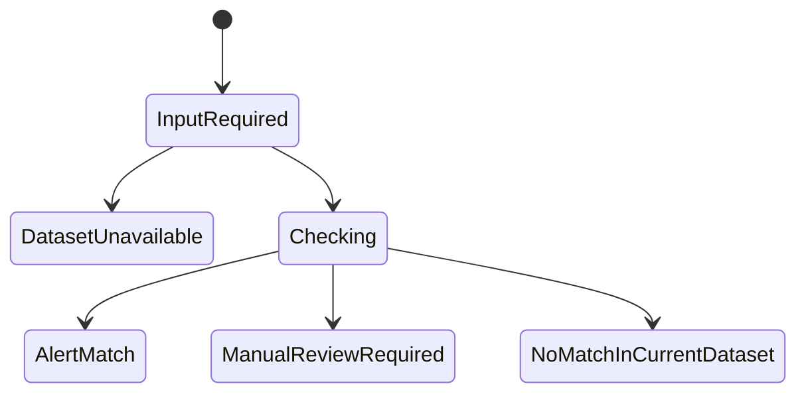

# MedEasy — User Flows and State Transitions

## 1. Primary user: patient/caregiver

### Flow A — Upload prescription and confirm extracted medicines

1. User opens “Scan prescription”.
2. User selects JPG/JPEG, PNG, WEBP or PDF (10 MB maximum, PDF up to four pages per current backend behavior).
3. Frontend validates file size/type and shows selected file preview.
4. User explicitly clicks “Extract medicine details”.
5. Backend processes the file and calls Gemini Vision.
6. UI shows an “AI-assisted draft — review before continuing” state.
7. Each extracted item displays medicine name, strength, dosage form, instructions (if legible), confidence and uncertainty text.
8. User edits or removes each item, marks unreadable items, and confirms each usable item.
9. Continue button remains disabled until at least one item is confirmed and no invalid required field remains.
10. Frontend calls the confirmed-search route using only confirmed items.

**Manual fallback:** User can bypass extraction and search by name. Never trap the user in a failed OCR state.

**Failure branches:**
- Unsupported file → explain accepted formats.
- File too large/page limit exceeded → explain limit and allow a smaller image/PDF.
- Gemini timeout/rate limit/provider error → show retry and manual search.
- Low confidence → highlight uncertainty, do not auto-fill hidden assumptions.
- Unreadable drug/strength → do not search until user manually corrects or removes it.

### Flow B — Search catalogue and compare listed prices

1. User enters a medicine name or submits reviewed prescription items.
2. Frontend requests catalogue search/confirmed prescription search.
3. UI shows exact catalogue matches and clearly marked partial/no matches.
4. User opens a medicine comparison card.
5. UI shows private-brand, Jan Aushadhi and Dava India prices only when present.
6. UI displays data source/freshness/pack limitation.
7. “Best listed price” is shown only where deterministic logic has valid values; savings is shown only if pack comparability is verified.
8. If comparability is unknown, show the prices side by side and say the packs may not be directly comparable.
9. User adds an item to cart.

**Safety branch:** Never show “recommended substitute”, “equivalent” or “switch to this” from salt/name matching alone. If the user asks about alternatives, direct them to a qualified pharmacist/prescriber.

### Flow C — Cart review

1. User opens cart.
2. User edits quantities or removes items.
3. UI updates indicative subtotal only where price type/quantity semantics are clear.
4. UI states that it is not a pharmacy quote, confirmed order or payment total.
5. User proceeds to nearby pharmacy search.

### Flow D — Find nearby pharmacy

1. User chooses “Use my location” or manual locality/PIN search.
2. Browser asks for geolocation permission only after user action.
3. If allowed and provider configured, frontend calls Google Places.
4. UI shows results in list/map; provider metadata and address are shown only when returned.
5. User may filter/sort using data the provider supports.
6. User selects a pharmacy.

**Failure branches:**
- Permission denied → manual locality/PIN search.
- Places key/config/billing/quota error → explain service unavailable and offer clearly labelled curated demo directory if one exists.
- No results → broaden radius or edit locality.
- Curated directory fallback → label it as demo/reference data; do not represent as live stock or live Places.

### Flow E — Prepare WhatsApp enquiry

1. User confirms selected pharmacy and cart items.
2. UI previews the enquiry text.
3. Message contains only medicine name, strength/form/pack if known, requested quantity and questions about availability, quote, manufacturer, batch and expiry.
4. UI states: “WhatsApp will open with a prefilled message. Review and press Send in WhatsApp.”
5. Backend saves the enquiry record.
6. User clicks “Open WhatsApp”.
7. WhatsApp opens in app/browser; user manually reviews and sends.
8. MedEasy must not display “sent” or “delivered” unless it receives verified status via a real integration (not part of MVP).

**Failure branches:**
- Pharmacy phone missing/invalid → allow copy enquiry text; no WhatsApp deeplink.
- WhatsApp unavailable → show copy text and phone number.
- Enquiry save fails → still allow copying/opening message only after making it clear it was not saved; offer retry.

### Flow F — Record pharmacy response

MVP approach: manual response form or controlled demo form.

1. User or shopkeeper opens the relevant enquiry response form.
2. Form records availability, quoted price, manufacturer, batch number, expiry date and delivery information.
3. Required fields for batch check are product, manufacturer and batch number; missing fields create `manual_review_required` or prevent check.
4. Save response through backend response endpoint.
5. UI labels source: “Manually entered pharmacy response” or “Demo response (simulated)”.

Do not pretend that a WhatsApp reply is automatically parsed.

### Flow G — Batch-alert check

1. User selects the product and enters or confirms manufacturer and batch number from the pharmacy response/pack.
2. Frontend calls batch checker.
3. Backend checks the loaded CSV.
4. UI renders one of:
   - **Alert match:** exact matching record details, notice date, alert type and source link.
   - **Manual review required:** candidate match/insufficient product or manufacturer context; do not display as a definitive match.
   - **No matching alert found:** explicitly state the current dataset coverage and that this is not a safety certificate.
   - **Dataset unavailable:** explain that no usable alert file is loaded.
5. UI displays last-updated/coverage metadata only if recorded and available.

### Flow H — Optional pack photo cross-check (stretch only)

1. User uploads photo of strip/carton after receiving medicine.
2. Vision/OCR extracts visible product, strength, manufacturer, batch, expiry.
3. User reviews and confirms fields.
4. App compares photo text to shopkeeper response and alert records.
5. UI shows `details_match`, `details_differ`, `alert_match`, `unable_to_read` or `dataset_unavailable`.
6. Label this as a pack-details cross-check. Never call it authenticity verification.

## 2. State machines

### Prescription item

Only `Confirmed` items are eligible for catalogue search.

### Enquiry

`AwaitingPharmacy` means the enquiry is recorded and the user may have manually sent it; it does not prove delivery or a shopkeeper response.

### Batch check

Never add a `Safe` or `Authentic` terminal state.

## 3. Pharmacy / shopkeeper flow (minimal MVP)

1. Open response form associated with an enquiry ID.
2. Review cart request.
3. Choose available/partially available/unavailable.
4. Enter quoted price where known.
5. Enter manufacturer, batch and expiry for exact available pack.
6. Enter delivery availability/fee/ETA if offered.
7. Save.

If there is no real pharmacy login, this is a demo/admin response form; label the mode and do not imply authenticated partner access.

## 4. Core user-facing language

| Avoid | Use |
|---|---|
| “AI verified prescription” | “AI-assisted transcription — review before continuing” |
| “Recommended generic equivalent” | “Other listed catalogue prices; ask your pharmacist/prescriber before changing brands or formulations” |
| “In stock near you” (from Places only) | “Nearby pharmacy listing — contact the pharmacy to confirm stock” |
| “WhatsApp sent” | “WhatsApp opened with a prefilled message; press Send in WhatsApp” |
| “Medicine is safe” | “No matching alert found in the imported dataset; this is not a safety certificate” |
| “Authenticity verified” | “Pack details cross-check” |
| “Order placed” | “Enquiry prepared/saved” |
